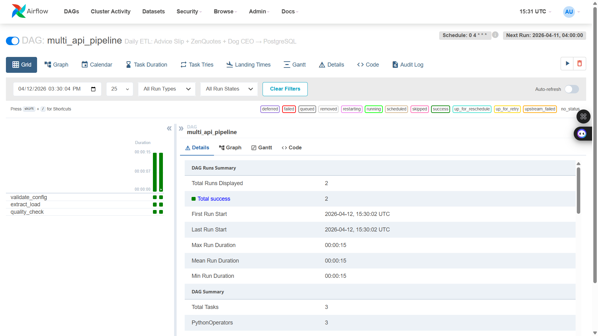

# 🐾 Multi-API to PostgreSQL: Orchestrated ETL Pipeline

**Multi-API to PostgreSQL** is a production-grade data engineering solution that bridges three independent public REST APIs and a relational PostgreSQL store. It implements a modular **ELT pipeline** — Extract (HTTP with retry), Transform (schema normalisation), Load (idempotent UPSERT) — orchestrated daily by Apache Airflow and packaged in Docker Compose for zero-friction deployment.

---

## 🎯 Project Goal

Public APIs expose structured data in inconsistent shapes: list wrappers, nested objects, URL-encoded metadata. This project demonstrates the core data engineering competency of ingesting heterogeneous API responses into a clean, queryable relational schema — with full pipeline observability, retry resilience, and Airflow-scheduled automation. Three free public APIs are used: Advice Slip (wisdom snippets), ZenQuotes (attributable quotations), and Dog CEO (breed image library).

---

## 🧬 System Architecture

1. **Extraction (BaseExtractor + subclasses):** A shared HTTP client handles all API calls with configurable exponential-backoff retry (`MAX_RETRIES=3`). On rate-limit (HTTP 429), it backs off with `2^attempt` seconds before retrying. All three extractors (`AdviceExtractor`, `QuoteExtractor`, `DogExtractor`) inherit this behaviour, ensuring transient network failures never produce silent data gaps.

2. **Transformation (transformers.py):** Each raw API response is normalised into a Python dict matching the target table schema. URL-based breed extraction parses Dog CEO image paths (`/breeds/<slug>/`) into human-readable breed names. ZenQuotes responses (a JSON list) are unwrapped and deduplicated by a `quote_key` derived from the quote text hash.

3. **Loading (DatabaseConnection):** A single persistent `psycopg2` connection is held open across the entire batch — eliminating the per-INSERT connection overhead of the original design. All three `INSERT` statements use `ON CONFLICT DO NOTHING`, making every run fully idempotent. The `execute()` method returns `rowcount`, allowing the pipeline to distinguish inserted rows from skipped duplicates.

4. **Audit Trail (pipeline_runs table):** Every run — whether triggered manually or by Airflow — writes a record to `pipeline_runs` with per-source insert/skip counts, run status (`SUCCESS`/`FAILED`), trigger source, and wall-clock duration. This gives complete pipeline lineage without external tooling.

5. **Orchestration (Apache Airflow 2.8):** A `LocalExecutor` DAG (`multi_api_pipeline`) runs daily at 07:00 EAT. Three tasks enforce a strict dependency chain: `validate_config → extract_load → quality_check`. The quality check task reads the latest `pipeline_runs` record and raises on any non-SUCCESS status, ensuring Airflow alerts on silent failures.

6. **Infrastructure (Docker Compose):** A single `docker-compose up` starts four services: PostgreSQL (pipeline data + Airflow metadata in separate databases), Airflow init (one-shot DB migration + admin user creation), webserver (UI at `localhost:8080`), and scheduler. The project directory is bind-mounted into the Airflow containers so DAGs can import `src.*` directly without packaging.

---

## 🛠️ Technical Stack

| Layer | Tool | Version |
|---|---|---|
| **Orchestration** | Apache Airflow | 2.8.1 |
| **Language** | Python | 3.12 |
| **Database** | PostgreSQL | 15 (Docker) |
| **HTTP Client** | requests | 2.31.0 |
| **DB Driver** | psycopg2-binary | 2.9.9 |
| **Config** | python-dotenv | 1.0.0 |
| **Testing** | pytest + pytest-mock | 7.4.3 |
| **Infrastructure** | Docker Compose | v3.8 |

---

## 📊 Performance & Results

- **3 APIs** ingested per run: Advice Slip, ZenQuotes, Dog CEO
- **4 tables** managed: `advice_quotes`, `quotes`, `dog_images`, `pipeline_runs`
- **3 retry attempts** with exponential backoff on any network failure
- **1 DB connection** per batch (reduced from N connections in original design)
- **Idempotent runs** — re-running the same batch inserts 0 duplicate rows
- **Audit record** written after every run with per-source insert/skip counts and wall-clock duration
- **3-task Airflow DAG** with linear dependency enforcement and quality gate
- **Daily schedule** at 07:00 EAT via Airflow cron (`0 4 * * *` UTC)

---

## 📸 Pipeline Overview

### Airflow DAG — Live Run (2 successful runs, 15s mean duration)



*DAG: `multi_api_pipeline` — 3 tasks (validate_config → extract_load → quality_check), all PythonOperators, scheduled daily at 07:00 EAT.*

### Data Flow

```
                    ┌──────────────────────────────────────────┐
                    │           Airflow DAG (daily)            │
                    │  validate_config → extract_load →        │
                    │  quality_check                           │
                    └──────────────┬───────────────────────────┘
                                   │
               ┌───────────────────┼───────────────────┐
               ▼                   ▼                   ▼
      AdviceExtractor        QuoteExtractor        DogExtractor
      adviceslip.com         zenquotes.io          dog.ceo/api
               │                   │                   │
       transform_advice    transform_quote     transform_dog_image
               │                   │                   │
               └───────────────────┼───────────────────┘
                                   ▼
                        DatabaseConnection
                     (single persistent conn)
                                   │
            ┌──────────────────────┼──────────────────────┐
            ▼                      ▼                      ▼
     advice_quotes              quotes              dog_images
            └──────────────────────┼──────────────────────┘
                                   ▼
                            pipeline_runs
                          (audit per run)
```

---

## 🗂️ Data Sources

| Source | API Endpoint | Data Captured | Dedup Key |
|---|---|---|---|
| Advice Slip | `api.adviceslip.com/advice` | Unique advice text + ID | `advice_id` (integer) |
| ZenQuotes | `zenquotes.io/api/random` | Quote text + attributed author | `quote_key` (hash of text) |
| Dog CEO | `dog.ceo/api/breeds/image/random` | Breed name + image URL | `image_url` (unique URL) |

---

## 🧠 Key Design Decisions

- **Single connection per batch, not per INSERT:** The original implementation opened and closed a new `psycopg2` connection for every row it inserted. On a batch of 10, that's 30 TCP handshakes and 30 authentication round-trips to the database. The refactored `DatabaseConnection` opens one connection at the start of the batch and closes it in a `finally` block. This is the standard pattern for short-lived ETL jobs that don't need connection pooling.

- **Exponential backoff, not silent failure:** The original `_get()` method caught `RequestException` and returned `None` — meaning a temporary network blip would silently drop a record with no indication of how many retries were attempted. The new implementation retries up to `MAX_RETRIES` times with `2^attempt` second delays, distinguishes rate-limit (429) responses from general errors, and only returns `None` after exhausting all attempts. This is the difference between a script and a resilient pipeline.

- **`pipeline_runs` audit table over log-only observability:** Logs are ephemeral and hard to query. Writing a structured record to `pipeline_runs` after every execution means you can answer "how many records did the pipeline insert last Tuesday?" with a simple SQL query. This is the same pattern used in production Airflow deployments and mirrors the audit trail design in the NSE Stock Pipeline and LedgerSync projects.

- **`quotes` table replacing `activities`:** The original design inherited the schema from the Bored API (a different API that was never actually used), leaving `participants`, `price`, and `accessibility` columns hardcoded to `1`, `0.0`, and `0.0` on every row. That's a structural lie in the data model — the table claimed to represent activities but contained quotes. The new `quotes` table has `quote_key`, `quote_text`, and `author` — fields that match what ZenQuotes actually returns.

- **`quote_key` as `abs(hash(quote_text))`:** ZenQuotes has no stable record ID in its response. Using Python's built-in `hash()` on the quote text generates a deterministic integer that serves as the dedup key. `abs()` ensures the value is always non-negative, which maps cleanly to PostgreSQL's `BIGINT`. Re-running the pipeline on the same quote will always produce the same key and trigger `ON CONFLICT DO NOTHING`.

- **LocalExecutor over CeleryExecutor:** For a single-machine portfolio project, CeleryExecutor adds Redis, a worker pool, and Flower — none of which change the pipeline behaviour. LocalExecutor runs tasks as subprocesses on the scheduler container and requires only PostgreSQL as a metadata backend (which is already in the stack). The switch to CeleryExecutor is a one-line change to `AIRFLOW__CORE__EXECUTOR` when horizontal scaling is needed.

---

## 📂 Project Structure

```text
multi-api-to-postgres/
├── dags/
│   ├── __init__.py
│   └── multi_api_pipeline.py   # Airflow DAG: validate → extract_load → quality_check
├── logs/                        # Pipeline log files (gitignored)
├── sql/
│   ├── create_tables.sql        # DDL: advice_quotes, quotes, dog_images, pipeline_runs
│   ├── init_databases.sh        # Creates airflow DB on first postgres container start
│   └── sample_queries.sql       # Analytics, data quality, and monitoring queries
├── src/
│   ├── __init__.py
│   ├── config.py                # Centralised config: DB credentials, API URLs, retry settings
│   ├── database.py              # DatabaseConnection: persistent conn, execute, log_pipeline_run
│   ├── extractors.py            # AdviceExtractor, QuoteExtractor, DogExtractor (with retry)
│   ├── pipeline.py              # Orchestrates extract → transform → load, writes audit record
│   └── transformers.py          # Schema normalisation: transform_advice, transform_quote, transform_dog_image
├── tests/
│   ├── __init__.py
│   └── test_pipeline.py         # Unit tests for extractors, transformers, and database layer
├── .env                         # Local credentials (gitignored)
├── .env.example                 # Template for environment variables
├── docker-compose.yml           # PostgreSQL + Airflow (init, webserver, scheduler)
├── pytest.ini                   # Test configuration
├── requirements.txt             # Python dependencies
└── run_pipeline.py              # CLI entry point for manual runs
```

---

## ⚙️ Installation & Setup

### Option A — Manual (local Python + existing PostgreSQL)

**1. Install dependencies**
```bash
pip install -r requirements.txt
```

**2. Configure environment**
```bash
cp .env.example .env
# Edit .env with your PostgreSQL credentials
```

**3. Create tables**
```bash
psql -h localhost -p 5432 -U postgres -d etl_pipeline -f sql/create_tables.sql
```

**4. Run the pipeline**
```bash
python run_pipeline.py --batch-size 3 --log-level INFO
```

**5. Run tests**
```bash
pytest tests/ -v
```

---

### Option B — Docker Compose (recommended: full Airflow stack)

**1. Start all services**
```bash
docker-compose up airflow-init   # one-time: DB migration + admin user
docker-compose up -d             # start postgres, webserver, scheduler
```

**2. Access services**

| Service | URL | Credentials |
|---|---|---|
| Airflow UI | http://localhost:8080 | admin / admin |
| PostgreSQL | localhost:5433 | postgres / postgres |

**3. Trigger the DAG manually**

In the Airflow UI, find `multi_api_pipeline` → unpause → click **Trigger DAG**.

Or via CLI:
```bash
docker exec airflow-scheduler airflow dags trigger multi_api_pipeline
```

**4. Tear down**
```bash
docker-compose down -v   # removes containers and volumes
```

---

## 🗃️ Data Model

```sql
-- Unique pieces of advice with source IDs from Advice Slip API
CREATE TABLE advice_quotes (
    id          SERIAL PRIMARY KEY,
    advice_id   INTEGER UNIQUE NOT NULL,   -- stable ID from API
    advice_text TEXT    NOT NULL,
    fetched_at  TIMESTAMP DEFAULT CURRENT_TIMESTAMP
);

-- Attributed quotations from ZenQuotes API
CREATE TABLE quotes (
    id         SERIAL PRIMARY KEY,
    quote_key  BIGINT UNIQUE NOT NULL,     -- abs(hash(quote_text))
    quote_text TEXT   NOT NULL,
    author     TEXT   NOT NULL,
    fetched_at TIMESTAMP DEFAULT CURRENT_TIMESTAMP
);

-- Dog breed images from Dog CEO API
CREATE TABLE dog_images (
    id        SERIAL PRIMARY KEY,
    breed     TEXT,
    image_url TEXT UNIQUE NOT NULL,        -- URL is the natural dedup key
    fetched_at TIMESTAMP DEFAULT CURRENT_TIMESTAMP
);

-- Pipeline execution audit trail
CREATE TABLE pipeline_runs (
    id               SERIAL PRIMARY KEY,
    run_at           TIMESTAMP DEFAULT CURRENT_TIMESTAMP,
    triggered_by     TEXT    NOT NULL DEFAULT 'manual',  -- 'manual' | 'airflow'
    status           TEXT    NOT NULL,                   -- 'SUCCESS' | 'FAILED'
    advice_inserted  INTEGER DEFAULT 0,
    advice_skipped   INTEGER DEFAULT 0,
    quotes_inserted  INTEGER DEFAULT 0,
    quotes_skipped   INTEGER DEFAULT 0,
    dogs_inserted    INTEGER DEFAULT 0,
    dogs_skipped     INTEGER DEFAULT 0,
    duration_seconds NUMERIC(8, 2)
);
```

---

## 🎓 Skills Demonstrated

- **Apache Airflow DAG design** — 3-task linear DAG with `PythonOperator`, `depends_on_past`, retry logic, and a post-run quality gate. Directly maps to JD requirements for "Airflow pipeline development" and "workflow orchestration."

- **Resilient API integration** — Exponential-backoff retry with HTTP 429 handling across 3 APIs. Demonstrates awareness of production failure modes (rate limits, transient network errors) that interviewers probe in data engineering rounds.

- **Idempotent ELT design** — `ON CONFLICT DO NOTHING` on all three load targets ensures the pipeline can be re-run safely. This is a fundamental requirement for any scheduled batch pipeline where re-processing is the recovery strategy.

- **Connection lifecycle management** — Single persistent `psycopg2` connection across a batch with `finally`-block cleanup. Maps to "PostgreSQL / relational database experience" and demonstrates understanding of connection overhead in high-frequency ETL.

- **Pipeline observability** — Structured audit records in `pipeline_runs` with per-source insert/skip counts, trigger provenance, and wall-clock timing. Maps to "monitoring and alerting" requirements and reflects production data engineering practice.

- **Docker Compose multi-service orchestration** — Four-service compose file with health checks, service dependencies, and shared environment variable blocks. Maps to "Docker / containerisation" JD keywords and demonstrates ability to package a full data stack.

- **Schema design for heterogeneous sources** — Three tables with appropriate dedup strategies (integer ID, text hash, natural URL key). Maps to "data modelling" and "relational schema design" requirements.

- **Test-driven quality assurance** — pytest suite covering extractor retry behaviour, transformer edge cases (None, wrong type, missing fields), and database rowcount contract. Maps to "software engineering best practices" requirements in data engineering JDs.
